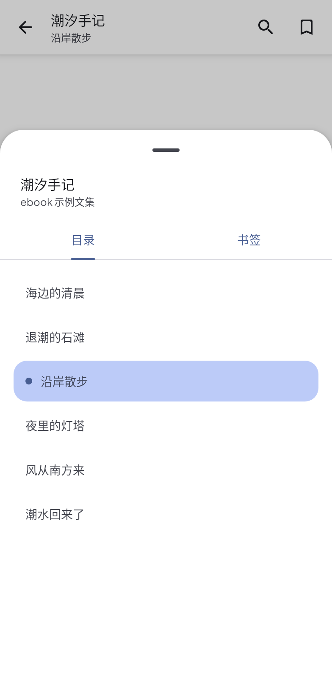

# ebook

Android 本地 EPUB 阅读器。用文件管理器打开一本书，或把整个文件夹导入书架，阅读进度和书签保存在设备上。

## 下载

**[下载最新版 APK](https://github.com/le-zhu/ebook/releases/latest)**。在发布页的 **Assets** 中选择 `ebook-版本号.apk`。支持 Android 7.0 及以上版本。

## 界面截图

<p>
  
  
</p>

图中使用示例书籍，分别展示书架和阅读时的目录。

## 使用方法

- **导入书籍**　点书架右上角的「＋」选择文件夹，应用会扫描它和子文件夹中的 EPUB。文件夹里新增书后，再选一次即可补充导入，内容相同的文件会自动去重。
- **打开单本**　在文件管理器中点选 EPUB，选择用 ebook 打开。应用会把这一本复制到自己的书架，再次打开时可以从上次的位置继续读。
- **目录与书签**　阅读时轻点页面中央，点底部的「目录 / 书签」。点目录标题可跳转，点右侧箭头可展开子目录。点顶部的书签图标可以收藏当前位置。
- **全文搜索**　点阅读页顶部的放大镜。打开匹配结果后，可以点「返回原阅读位置」，也可以点旁边的叉号清除高亮并留在结果处。
- **调整排版**　「原书排版」沿用书中样式。「默认排版」是可调整的全局设置，「本书自定义」只影响当前书籍。后两种均采用从左到右的横排。

## 本地编译

项目使用 Kotlin、Jetpack Compose Material 3 和 Readium 3.4.0。用 Android Studio 打开仓库根目录，安装 Android SDK 37.1 和 Build Tools 37.0.0 后，选择 `app` 即可运行。

也可以在仓库根目录用 Windows PowerShell 构建和测试。

```powershell
.\gradlew.bat :app:assembleDebug
.\gradlew.bat :app:testDebugUnitTest
.\gradlew.bat :app:assembleRelease
```

调试包位于 `app/build/outputs/apk/debug/app-debug.apk`。正式包位于 `app/build/outputs/apk/release/`，使用 R8 裁剪未使用的代码和资源。自行编译的正式包需要签名才能安装，覆盖升级需使用与已安装版本相同的签名。
